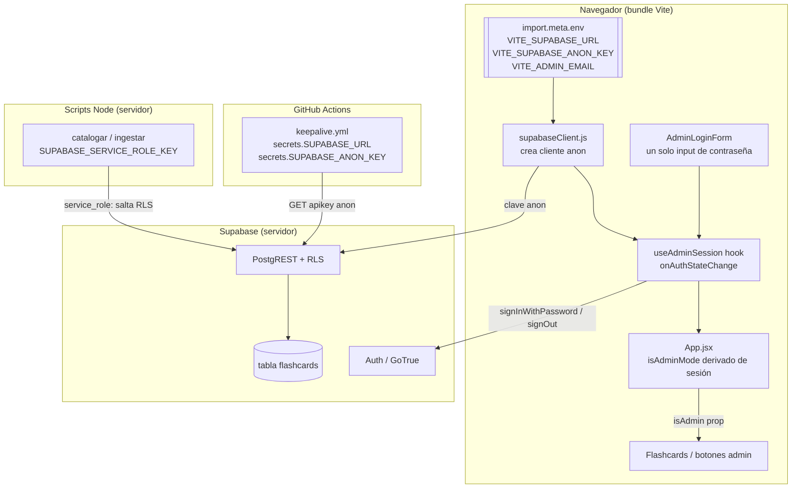
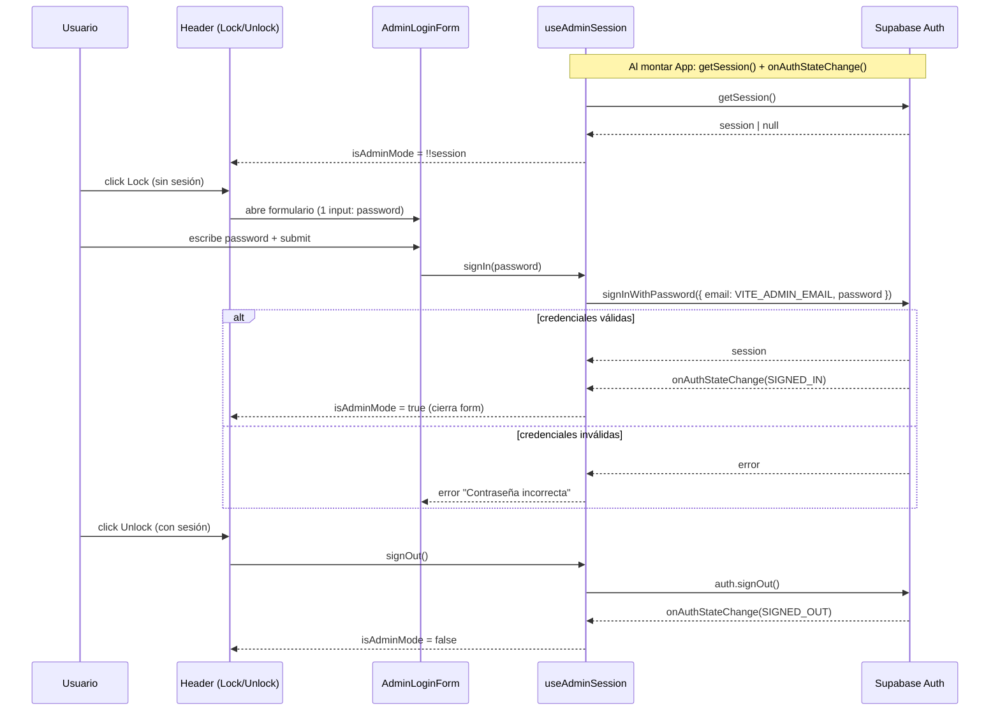
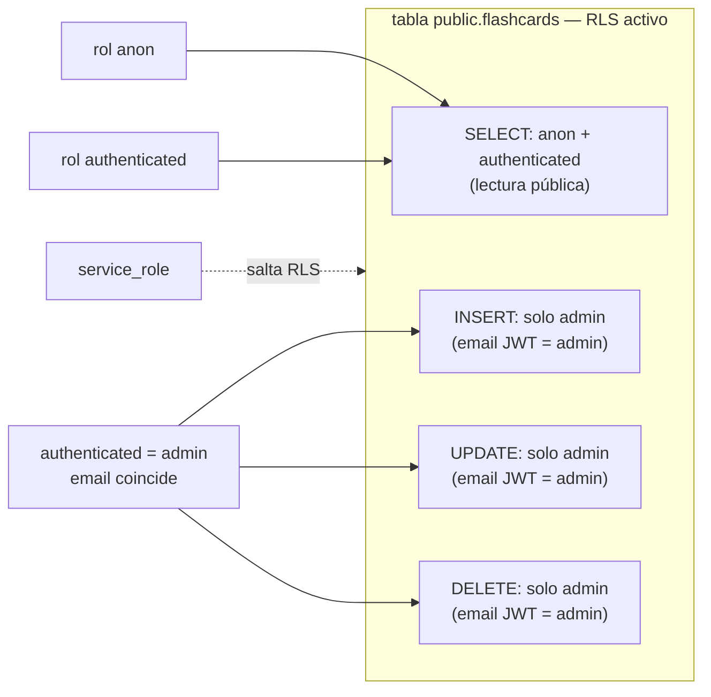

# Design Document: admin-auth-security

## Overview

Esta feature endurece la seguridad del SPA `arabe-flashcards` en tres frentes: (1) mover las credenciales del cliente Supabase (URL + clave `anon`) fuera del código fuente hacia variables de entorno `import.meta.env.VITE_*`, con fallo ruidoso si faltan; (2) sustituir la contraseña `"1234"` embebida y el `prompt()` por un **modo admin de clave única** respaldado por Supabase Auth (`signInWithPassword`) contra un único usuario cuyo email se define por entorno, derivando `isAdminMode` del estado de sesión real; y (3) definir políticas **Row Level Security (RLS)** sobre la tabla `flashcards` que permitan lectura pública pero restrinjan la escritura exclusivamente al usuario admin, identificado por su email en el JWT (no a cualquier usuario autenticado).

El principio rector es que la "seguridad" actual es puramente de interfaz (ocultar botones): cualquiera puede escribir en `flashcards` desde la consola del navegador usando la clave `anon`. La defensa real es RLS en el servidor; el modo admin de la app pasa a ser una capa de autenticación legítima (sesión Supabase) en lugar de un candado cosmético. Los scripts de servidor (`catalogar`, `ingestar`) usan `service_role`, que se salta RLS, por lo que no se ven afectados.

El diseño es deliberadamente conservador: no toca el sistema de familias, los juegos ni los scripts salvo lo imprescindible, mantiene la carga perezosa de `openai` y `pdfjs-dist`, y preserva los límites de `build` y `lint`.

---

## Architecture

### Diagrama de componentes



### Modelo de confianza y fronteras

| Actor | Credencial | Alcance RLS | Fuente de la credencial |
|-------|-----------|-------------|-------------------------|
| Visitante anónimo | clave `anon` | SELECT en `flashcards` | `VITE_SUPABASE_ANON_KEY` (expuesta al navegador, es seguro) |
| Admin logueado | sesión JWT (`authenticated`, email = admin) | SELECT + INSERT/UPDATE/DELETE (escritura solo si el email del JWT coincide con el del admin) | `signInWithPassword` con `VITE_ADMIN_EMAIL` + password |
| Scripts servidor | `service_role` | se salta RLS | `SUPABASE_SERVICE_ROLE_KEY` (nunca con prefijo `VITE_`) |
| Keepalive CI | clave `anon` | SELECT | `secrets.SUPABASE_ANON_KEY` |

Frontera crítica: **cualquier variable con prefijo `VITE_` acaba en el bundle del navegador**. Por eso la clave `anon` y `VITE_ADMIN_EMAIL` pueden llevar el prefijo (son públicas por diseño), pero `SUPABASE_SERVICE_ROLE_KEY` **jamás** debe llevarlo.

### Flujo de autenticación del modo admin



### Políticas RLS (modelo de datos / servidor)



No se añaden columnas ni se cambia el esquema de `flashcards` (sigue con `familias text[]`). RLS solo cambia *quién* puede hacer *qué*.

---

## Components and Interfaces

### Componente 1: `src/supabaseClient.js` (modificado)

**Propósito**: crear el cliente Supabase a partir de variables de entorno, con fallo ruidoso si faltan.

```javascript
// src/supabaseClient.js
import { createClient } from '@supabase/supabase-js'

const supabaseUrl = import.meta.env.VITE_SUPABASE_URL
const supabaseKey = import.meta.env.VITE_SUPABASE_ANON_KEY

if (!supabaseUrl || !supabaseKey) {
  console.error(
    '[supabaseClient] Faltan variables de entorno. Define VITE_SUPABASE_URL y ' +
    'VITE_SUPABASE_ANON_KEY en tu .env (local) o en el panel de variables del hosting (producción).'
  )
}

export const supabase = createClient(supabaseUrl, supabaseKey)
```

**Especificación formal**

- **Precondiciones**: ninguna (puede ejecutarse con env ausente).
- **Postcondiciones**:
  - Si ambas variables están definidas → `supabase` es un cliente funcional apuntando al proyecto correcto.
  - Si falta alguna → se emite **exactamente un** `console.error` descriptivo; `createClient` recibe `undefined` y el error posterior de red es atribuible (no un fallo silencioso).
  - No hay ninguna URL ni clave literal en el código fuente.
- **Invariantes**: el módulo exporta una única instancia `supabase` (singleton), igual que antes; ningún otro archivo cambia su forma de importarlo.

**Nota de decisión**: no se lanza `throw` para no romper el render de la pantalla de bienvenida de forma opaca; se prefiere `console.error` + fallo atribuible en la primera llamada a red, tal como pide el objetivo ("no fallar en silencio", "no romper el arranque de forma opaca").

### Componente 2: `useAdminSession` (hook nuevo, en `src/App.jsx` o `src/useAdminSession.js`)

**Propósito**: encapsular la sesión de Supabase Auth y derivar el estado de admin. Es la única fuente de verdad de `isAdminMode`.

```javascript
// Firma del hook
function useAdminSession(): {
  session: Session | null,      // sesión Supabase actual
  isAdminMode: boolean,         // === !!session (derivado, no manual)
  loading: boolean,             // true mientras se resuelve la sesión inicial o un login
  error: string | null,         // mensaje de error de login para la UI
  signIn: (password: string) => Promise<void>,
  signOut: () => Promise<void>,
  clearError: () => void,
}
```

**Pseudocódigo**

```javascript
function useAdminSession() {
  const [session, setSession] = useState(null)
  const [loading, setLoading] = useState(true)
  const [error, setError] = useState(null)

  useEffect(() => {
    let mounted = true
    // 1. Resolver sesión existente al montar
    supabase.auth.getSession().then(({ data }) => {
      if (mounted) { setSession(data.session); setLoading(false) }
    })
    // 2. Suscribirse a cambios (SIGNED_IN / SIGNED_OUT / TOKEN_REFRESHED)
    const { data: sub } = supabase.auth.onAuthStateChange((_event, newSession) => {
      if (mounted) setSession(newSession)
    })
    return () => { mounted = false; sub.subscription.unsubscribe() }
  }, [])

  async function signIn(password) {
    setError(null); setLoading(true)
    const email = import.meta.env.VITE_ADMIN_EMAIL
    if (!email) {
      setError('Config incompleta: falta VITE_ADMIN_EMAIL')
      console.error('[useAdminSession] Falta VITE_ADMIN_EMAIL')
      setLoading(false); return
    }
    const { error } = await supabase.auth.signInWithPassword({ email, password })
    if (error) setError('Contraseña incorrecta')   // mensaje genérico, no filtra detalles
    setLoading(false)
    // onAuthStateChange actualizará `session` si el login fue correcto
  }

  async function signOut() {
    setLoading(true)
    await supabase.auth.signOut()
    setLoading(false)
  }

  return {
    session,
    isAdminMode: !!session,     // DERIVADO de la sesión, nunca un setState manual
    loading, error,
    signIn, signOut,
    clearError: () => setError(null),
  }
}
```

**Especificación formal**

- **Precondiciones**: `supabase` inicializado; `VITE_ADMIN_EMAIL` definido para que `signIn` funcione.
- **Postcondiciones**:
  - `isAdminMode === true` **si y solo si** existe una sesión Supabase válida.
  - Tras `signIn` con credenciales válidas: `session !== null` (vía `onAuthStateChange`), `error === null`.
  - Tras `signIn` con credenciales inválidas: `session === null`, `error` contiene un mensaje para la UI, sin filtrar si el fallo fue email o password.
  - Tras `signOut`: `session === null`, `isAdminMode === false`.
  - La suscripción a `onAuthStateChange` se cancela al desmontar (sin fugas).
- **Invariantes**: no existe ningún camino de código que ponga `isAdminMode = true` sin una sesión Supabase. La contraseña `"1234"` y `prompt()` han sido eliminados.

### Componente 3: `AdminLoginForm` (componente nuevo en `src/App.jsx`)

**Propósito**: formulario mínimo con un **único campo de contraseña**. Sin email, sin registro, sin recuperación, sin gestión de cuentas.

```javascript
// Props
function AdminLoginForm({
  onSubmit,     // (password: string) => Promise<void>  -> useAdminSession.signIn
  loading,      // boolean  -> deshabilita el botón y muestra spinner
  error,        // string | null -> mensaje bajo el input
  onClose,      // () => void -> cierra el formulario sin loguear
})
```

**Pseudocódigo (estructura JSX)**

```javascript
function AdminLoginForm({ onSubmit, loading, error, onClose }) {
  const [password, setPassword] = useState('')
  const handleSubmit = (e) => { e.preventDefault(); onSubmit(password) }
  return (
    <form onSubmit={handleSubmit}>
      <label>Contraseña de administrador</label>
      <input
        type="password"
        value={password}
        onChange={(e) => setPassword(e.target.value)}
        autoFocus
        disabled={loading}
        aria-label="Contraseña de administrador"
      />
      {error && <p role="alert" className="text-red-500">{error}</p>}
      <button type="submit" disabled={loading}>
        {loading ? <Loader className="animate-spin" /> : 'Entrar'}
      </button>
      <button type="button" onClick={onClose}>Cancelar</button>
    </form>
  )
}
```

**Especificación formal**

- **Precondiciones**: recibe `onSubmit`, `loading`, `error`, `onClose`.
- **Postcondiciones**: al enviar, invoca `onSubmit(password)` exactamente una vez por submit; muestra `error` con `role="alert"` cuando no es null; deshabilita controles mientras `loading`.
- **Invariantes**: el DOM **no** contiene ningún campo de email, enlace de registro, ni de recuperación de contraseña.

### Componente 4: `App.jsx` (modificado — integración)

Cambios concretos sobre el código real actual:

```javascript
// ELIMINAR (línea ~172):
const [isAdminMode, setIsAdminMode] = useState(false);

// ELIMINAR (línea ~235):
const handleAdminToggle = () => { if (isAdminMode) setIsAdminMode(false); else { const p = prompt("🔒 Contraseña:"); if (p === "1234") setIsAdminMode(true); } };

// AÑADIR en App(): usar el hook como única fuente de verdad
const { isAdminMode, loading: authLoading, error: authError, signIn, signOut, clearError } = useAdminSession();
const [isLoginOpen, setIsLoginOpen] = useState(false);

// NUEVO handler del candado:
const handleAdminToggle = () => {
  if (isAdminMode) {
    signOut();              // Unlock -> cerrar sesión
  } else {
    clearError();
    setIsLoginOpen(true);   // Lock -> abrir formulario
  }
};

// Cerrar el formulario automáticamente cuando la sesión se activa:
useEffect(() => { if (isAdminMode) setIsLoginOpen(false); }, [isAdminMode]);
```

- El botón `Lock/Unlock` del header (línea ~320) **no cambia de forma**: sigue llamando a `handleAdminToggle` y mostrando `Unlock` cuando `isAdminMode` es true.
- El gating de los botones admin (`{isAdminMode && (...)}`, línea ~327) y el prop `isAdmin={isAdminMode}` de `Flashcard` (línea ~340) **no cambian**: `isAdminMode` ahora proviene del hook en lugar del `useState`.
- Renderizar `<AdminLoginForm>` (modal/overlay) cuando `isLoginOpen && !isAdminMode`, cableado a `signIn`, `authLoading`, `authError`, y `onClose={() => setIsLoginOpen(false)}`.

---

## Data Models

### Variables de entorno (contratos)

```javascript
// Cliente (navegador) — prefijo VITE_ OBLIGATORIO, acaban en el bundle
VITE_SUPABASE_URL: string        // https://<ref>.supabase.co
VITE_SUPABASE_ANON_KEY: string   // JWT anon — público por diseño
VITE_ADMIN_EMAIL: string         // email del único usuario admin

// Scripts (servidor) — SIN prefijo VITE_, NUNCA en el navegador
SUPABASE_URL: string
SUPABASE_SERVICE_ROLE_KEY: string  // ⚠️ se salta RLS, jamás con VITE_
OPENAI_API_KEY: string
```

**Reglas de validación**:
- `VITE_SUPABASE_URL` y `VITE_SUPABASE_ANON_KEY` ausentes → `console.error` en `supabaseClient.js`.
- `VITE_ADMIN_EMAIL` ausente → `signIn` falla con error visible en UI + `console.error`.

### `.env.example` (reescrito)

```bash
# Copia este archivo a ".env" y rellena los valores reales.
# El archivo .env NO debe subirse a git (está en .gitignore).

# =========================================================
#  CLIENTE (frontend / navegador)
#  El prefijo VITE_ EXPONE la variable en el bundle del navegador.
#  Solo pon aquí valores que puedan ser públicos (clave anon, email admin).
# =========================================================
VITE_SUPABASE_URL=https://TU-PROYECTO.supabase.co
VITE_SUPABASE_ANON_KEY=tu-clave-anon
VITE_ADMIN_EMAIL=admin@tudominio.com

# =========================================================
#  SCRIPTS (servidor / línea de comandos)
#  SIN prefijo VITE_. NUNCA deben llegar al navegador.
# =========================================================
SUPABASE_URL=https://TU-PROYECTO.supabase.co

# ⚠️ service_role: permisos de administrador, SE SALTA RLS.
#    Solo para scripts de servidor. NUNCA con prefijo VITE_.
SUPABASE_SERVICE_ROLE_KEY=tu-clave-service-role

OPENAI_API_KEY=sk-...
```

### `supabase/rls-flashcards.sql` (archivo nuevo, generado en tareas, NO se ejecuta aquí)

```sql
-- Activa RLS y define políticas para public.flashcards.
-- Ejecutar en Supabase -> SQL Editor. service_role se salta RLS siempre.
--
-- ⚠️ IMPORTANTE: reemplaza el marcador '<EMAIL_DEL_ADMIN>' en TODAS las
--    políticas de escritura por el email real del usuario admin
--    (debe ser EXACTAMENTE el mismo valor que VITE_ADMIN_EMAIL).

alter table public.flashcards enable row level security;

-- Lectura pública (visitantes anónimos + autenticados)
create policy "flashcards_select_public"
  on public.flashcards for select
  to anon, authenticated
  using (true);

-- Escritura SOLO para el usuario admin, identificado por su email en el JWT.
-- No basta con estar autenticado: el email del token debe coincidir.
create policy "flashcards_insert_admin"
  on public.flashcards for insert
  to authenticated
  with check (auth.jwt() ->> 'email' = '<EMAIL_DEL_ADMIN>');

create policy "flashcards_update_admin"
  on public.flashcards for update
  to authenticated
  using (auth.jwt() ->> 'email' = '<EMAIL_DEL_ADMIN>')
  with check (auth.jwt() ->> 'email' = '<EMAIL_DEL_ADMIN>');

create policy "flashcards_delete_admin"
  on public.flashcards for delete
  to authenticated
  using (auth.jwt() ->> 'email' = '<EMAIL_DEL_ADMIN>');
```

### `keepalive.yml` (modificado)

```yaml
        env:
          SUPABASE_URL: ${{ secrets.SUPABASE_URL }}        # antes en claro, ahora secreto
          SUPABASE_ANON_KEY: ${{ secrets.SUPABASE_ANON_KEY }}
        run: |
          test -n "$SUPABASE_URL"
          test -n "$SUPABASE_ANON_KEY"
          # ...resto del curl sin cambios...
```

Requiere crear el secreto de GitHub `SUPABASE_URL` (paso manual documentado). Tras el cambio no queda ningún identificador de proyecto en claro en el repo.

---

## Correctness Properties

Propiedades universales que la implementación debe satisfacer (base para las tareas de verificación):

### Property 1: Sin credenciales en el código

`∀` archivo versionado del repo, no contiene la URL literal del proyecto Supabase ni la clave `anon` literal (ni en `supabaseClient.js` ni en `keepalive.yml`).

### Property 2: Fallo ruidoso de env cliente

Si `VITE_SUPABASE_URL` o `VITE_SUPABASE_ANON_KEY` están ausentes al cargar, se emite al menos un `console.error` descriptivo.

### Property 3: Admin derivado de sesión

`isAdminMode === true ⟺ existe sesión Supabase válida`. No existe ninguna ruta que active el modo admin sin sesión.

### Property 4: Sin secreto compartido en cliente

`"1234"` y `prompt()` no aparecen en el código tras la implementación.

### Property 5: Login de un solo campo

El formulario de admin contiene exactamente un input de contraseña y cero campos de email/registro/recuperación.

### Property 6: Separación de prefijos

Ninguna variable `service_role` lleva prefijo `VITE_` en `.env.example` ni en el código.

### Property 7: RLS correcto

Con RLS activo, un cliente `anon` solo puede `SELECT` (no `INSERT/UPDATE/DELETE`); un cliente `authenticated` cuyo email **no** coincide con el del admin tampoco puede escribir (solo `SELECT`); únicamente el admin (cuyo email en el JWT coincide con `VITE_ADMIN_EMAIL`) puede `INSERT/UPDATE/DELETE`; `service_role` se salta RLS y no se ve afectado.

### Property 8: Carga perezosa intacta

`openai` y `pdfjs-dist` siguen fuera del chunk inicial del bundle (solo `import()` dinámico).

### Property 9: Scripts intactos

`catalogar` e `ingestar` siguen funcionando con `service_role` sin cambios de comportamiento.

### Property 10: Presupuesto de calidad

`npm run build` pasa; `npm run lint` ≤ 22 problemas.

---

## Error Handling

| Escenario | Condición | Respuesta | Recuperación |
|-----------|-----------|-----------|--------------|
| Env cliente ausente | falta `VITE_SUPABASE_*` | `console.error` descriptivo; fallo de red atribuible | el usuario define las variables y recarga |
| `VITE_ADMIN_EMAIL` ausente | login sin email configurado | `signIn` no llama a Supabase; error en UI + `console.error` | configurar la variable |
| Credenciales inválidas | `signInWithPassword` devuelve error | mensaje genérico "Contraseña incorrecta" (`role="alert"`), sin filtrar detalle | reintentar |
| Red/Auth caída | excepción en `signIn/signOut` | capturar y mostrar error en UI; `loading` vuelve a false | reintentar |
| Escritura no autorizada | RLS rechaza INSERT/UPDATE/DELETE desde consola con clave anon, o con un `authenticated` cuyo email no es el del admin | Supabase devuelve error de política (403) | comportamiento esperado, es la defensa |
| Sesión expirada | `onAuthStateChange(SIGNED_OUT)` / token no renovado | `isAdminMode` pasa a false automáticamente; UI vuelve a modo lectura | relogin con el candado |

---

## Testing Strategy

### Unit / integración manual
- `supabaseClient.js`: simular env ausente y verificar el `console.error`.
- `useAdminSession`: login válido activa `isAdminMode`; login inválido deja `error`; `signOut` lo desactiva; cleanup de la suscripción al desmontar.
- `AdminLoginForm`: no renderiza campo de email; muestra `error`; deshabilita en `loading`.

### Verificación de propiedades (checks ejecutables)
- `grep` de que la URL/clave literal y `"1234"`/`prompt(` ya no existen en `src/` ni en `keepalive.yml`.
- `npm run build` finaliza con éxito e inspección del manifest para confirmar que `openai`/`pdfjs-dist` quedan en chunks dinámicos, no en el entry inicial.
- `npm run lint` devuelve ≤ 22 problemas.

### RLS (manual en Supabase)
- Con clave `anon`: `SELECT` OK, `INSERT/UPDATE/DELETE` rechazado.
- Con un usuario `authenticated` que NO sea el admin (email distinto): `SELECT` OK, `INSERT/UPDATE/DELETE` rechazado por política.
- Con el usuario admin logueado (email = `VITE_ADMIN_EMAIL`): `INSERT/UPDATE/DELETE` OK.
- Con `service_role` (scripts): las cuatro operaciones OK (se salta RLS).

---

## Security Considerations

- La clave `anon` y `VITE_ADMIN_EMAIL` son públicas por diseño (van en el bundle); la seguridad real recae en RLS, que restringe la escritura al admin por email, no en ocultar la clave.
- El error de login es genérico para no revelar si el fallo fue email o contraseña.
- No hay signup en la app: la cuenta admin se crea a mano en el panel de Supabase, reduciendo superficie de ataque.
- `service_role` queda estrictamente del lado servidor (scripts), nunca con prefijo `VITE_`.

---

## Dependencies

No se añaden dependencias nuevas. Se usan APIs ya disponibles de `@supabase/supabase-js` (`auth.signInWithPassword`, `auth.signOut`, `auth.getSession`, `auth.onAuthStateChange`) y `lucide-react` (`Loader`, `Lock`, `Unlock`, ya importados).

---

## Alcance documental adicional (entregables al terminar la implementación)

1. **Actualizar `docs/INFORME-PROYECTO.md`**:
   - **Sección 1 (Resumen ejecutivo)**: reflejar que la auth admin pasa a Supabase Auth y que RLS protege la escritura.
   - **Sección 7 (Problemas pendientes)**: retirar/actualizar los puntos de "Credenciales en el cliente" y "Contraseña de admin `1234`" una vez resueltos.
   - **Sección 8 (Prioridades sugeridas)**: marcar como completadas las prioridades 1 y 2.
2. **Lista de pasos manuales** (a incluir como entregable en tareas):
   - **Supabase**: crear el usuario admin (email = `VITE_ADMIN_EMAIL`, contraseña fuerte) en Authentication → Users → Add user, marcando la casilla **"Auto Confirm User"** para que el usuario quede confirmado sin necesidad de email de verificación; ejecutar `supabase/rls-flashcards.sql` en el SQL Editor (reemplazando antes el marcador `'<EMAIL_DEL_ADMIN>'` por el email real del admin); verificar las políticas.
   - **Supabase (desactivar registro público)**: en Authentication → Sign In / Providers, desactivar la opción **"Allow new users to sign up"** para impedir que cualquiera se registre.
   - **Hosting (producción)**: configurar `VITE_SUPABASE_URL`, `VITE_SUPABASE_ANON_KEY`, `VITE_ADMIN_EMAIL` como variables de entorno del build.
   - **GitHub**: crear el secreto `SUPABASE_URL` (además del ya existente `SUPABASE_ANON_KEY`) para `keepalive.yml`.
   - **Local**: actualizar `.env` siguiendo el nuevo `.env.example`.

---

## Restricciones (constraints del diseño)

- `npm run build` debe seguir pasando.
- `npm run lint` NO debe superar los 22 problemas actuales.
- No tocar el sistema de familias, los juegos ni los scripts salvo lo imprescindible.
- `openai` y `pdfjs-dist` deben seguir cargándose de forma perezosa (fuera del bundle inicial).
