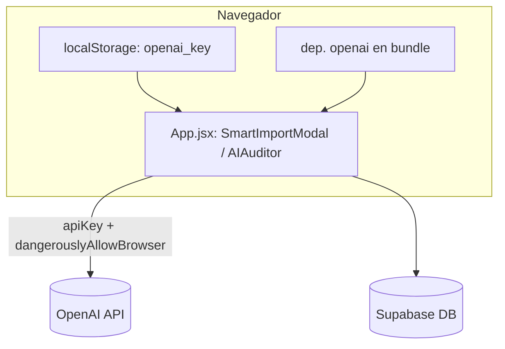
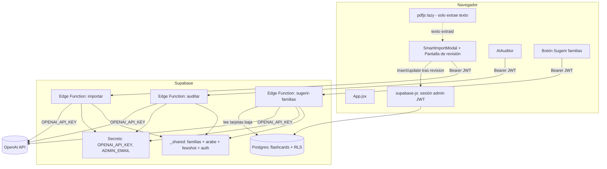
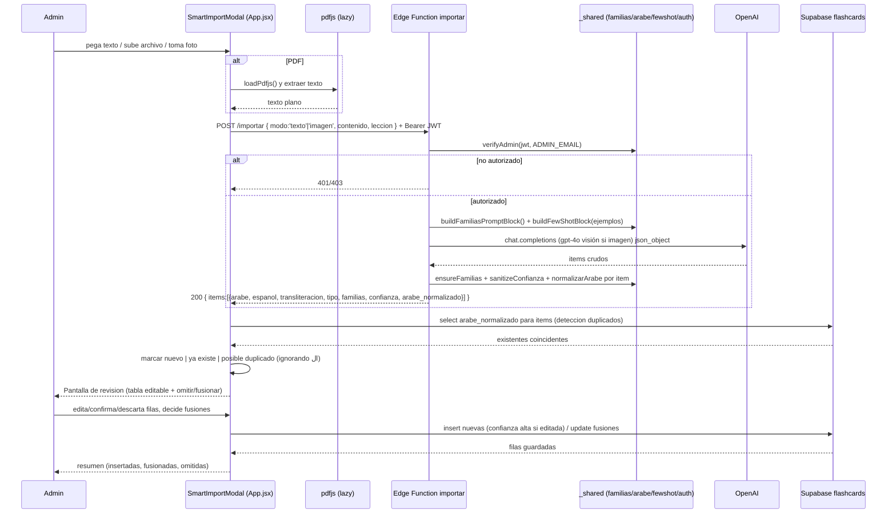

# Documento de Diseño: importacion-servidor

## Overview

Esta feature traslada **todas** las llamadas a OpenAI del navegador al servidor (Supabase Edge Functions, Deno/TypeScript), elimina del frontend la clave de API, la bandera `dangerouslyAllowBrowser` y la dependencia `openai`, y rediseña el flujo de importación de tarjetas del modo admin para que sea seguro, con revisión previa, detección de duplicados y clasificación por familias.

El trabajo se organiza en cuatro bloques independientes pero coordinados:

1. **IA en el servidor** — Edge Functions `importar`, `auditar` y `sugerir-familias`, protegidas por JWT + `ADMIN_EMAIL`, con un módulo neutro compartido que es la **fuente única** de familias/reglas/few-shot/normalización árabe.
2. **Tipo de tarjeta** — nueva columna `tipo` (`'palabra' | 'frase'`) con `CHECK`, migración SQL idempotente, relleno desde `catalogar-familias.js --solo-tipo`, sustitución de `getCardType()` y nuevo filtro en la vista principal.
3. **Flujo de importación en la app** — entrada por texto/archivo/cámara, extracción servidor (texto + visión), detección de duplicados contra BD con normalización compartida (ignorando el artículo `ال`), pantalla de revisión editable con omitir/fusionar, y reglas de confianza al guardar.
4. **Sugerir familias en la app** — botón en "Mantenimiento BD" que invoca la función `sugerir-familias` y muestra las propuestas (solo informativo).

El diseño respeta el código real existente: `src/constants/familias.js` (26 familias: 20 vocabulario + 6 gramática), los helpers `scripts/_arabe.js` y `scripts/_fewshot.js`, el patrón de migración de `supabase/add-familias-confianza.sql`, la auth admin por email (hook `useAdminSession` + RLS con `auth.jwt() ->> 'email'`) y el patrón de los scripts (gpt-4o/gpt-4o-mini, `response_format: json_object`). **No se tocan juegos, auth admin ni RLS.**

---

## Architecture

### Antes (estado actual)

El navegador habla directamente con OpenAI usando una clave que el admin pega en la UI y que se guarda en `localStorage('openai_key')`. El paquete `openai` se empaqueta en el frontend (carga perezosa).



### Después (objetivo)

El navegador nunca ve la clave. Llama a Edge Functions autenticadas con su JWT de admin; las funciones validan email contra `ADMIN_EMAIL`, leen `OPENAI_API_KEY` de los secretos y hablan con OpenAI. El paquete `openai` desaparece del frontend; solo `pdfjs` sigue (perezoso) para extraer texto de PDF en el navegador.



### Estrategia del módulo compartido (fuente única)

**Problema.** Las Edge Functions de Deno no pueden importar de forma fiable desde `src/` ni `scripts/`: Supabase empaqueta cada función de forma aislada, las rutas `../../src/...` fuera del árbol de la función no son portables, y Deno resuelve módulos por URL/ruta explícita, no por `node_modules`. Además:

- `src/constants/familias.js` es ESM puro de navegador/Node (sin imports de Node) → portable a Deno **tal cual**.
- `scripts/_arabe.js` es ESM puro sin imports de Node → portable a Deno **tal cual**.
- `scripts/_fewshot.js` usa `node:fs`, `node:path`, `node:url` → **no** portable a Deno sin cambios. Pero las funciones no necesitan *escribir* ejemplos; solo necesitan la parte pura `buildFewShotBlock(ejemplos)` a partir de un array y los datos de `ejemplos-familias.json`.

**Decisión.** La **fuente canónica vive directamente en `supabase/functions/_shared/`** (convención oficial de Supabase para código común entre funciones: el prefijo `_` evita que el CLI la despliegue como función), escrita como **ESM puro** (`.js`), **sin APIs de Deno ni de Node** (nada de `Deno.*`, `node:fs`, `node:path`, `node:url`, etc.). No existe ninguna carpeta `shared/` en la raíz del repo ni ningún paso de copia `predeploy`: la carpeta `_shared/` es la única ubicación editable y la consumen los tres entornos (Vite, Node y Deno) importando el mismo `.js` por ruta relativa.

```
supabase/functions/_shared/
  familias.js              # FUENTE CANÓNICA: datos de las 26 familias + reglas + funciones puras
  arabe.js                 # normalizarArabe (ESM puro)
  fewshot.js               # buildFewShotBlock(ejemplos) puro (parte pura, sin fs)
  ejemplos-familias.json   # datos few-shot (movido desde scripts/)
  auth.ts                  # verificación JWT + ADMIN_EMAIL + CORS (solo Edge)
  openai.ts                # helper fetch a la API de OpenAI (solo Edge)
```

Los módulos `.js` (`familias.js`, `arabe.js`, `fewshot.js`) y el JSON son neutros y portables a los tres entornos. Los módulos `auth.ts` y `openai.ts` son exclusivos de las Edge Functions (usan `Deno.env`, `fetch`, el cliente de Supabase) y no los consume ni Vite ni Node.

**Contenido de cada módulo canónico:**

- `supabase/functions/_shared/familias.js` — datos de las 26 familias (nombre, grupo, descripción, ejemplos) + reglas de clasificación + funciones puras: `FAMILIAS_A2_META`, `FAMILIAS_A2`, `FAMILIAS_A2_SET`, `CONFIANZAS`, `FAMILIA_FALLBACK`, `sanitizeFamilias`, `ensureFamilias`, `sanitizeConfianza`, `getCardFamilias`, `buildFamiliasPromptBlock`.
- `supabase/functions/_shared/arabe.js` — `normalizarArabe` (ESM puro).
- `supabase/functions/_shared/fewshot.js` — `buildFewShotBlock(ejemplos)` puro (sin `fs`; la parte Node vive solo en `scripts/_fewshot.js`).
- `supabase/functions/_shared/ejemplos-familias.json` — datos few-shot, **movido** desde `scripts/ejemplos-familias.json`.

**Consumo (todo son reexportaciones de la fuente canónica):**

- `src/constants/familias.js` pasa a **reexportar** desde `../../supabase/functions/_shared/familias.js` (Vite resuelve la ruta relativa a `.js` sin configuración extra). Sin segunda definición.
- `scripts/_arabe.js` **reexporta** desde `../supabase/functions/_shared/arabe.js` (Node ESM, ruta relativa). Compatibilidad intacta con `ingestar`/`deduplicar`.
- `scripts/_fewshot.js` **reexporta** la parte pura (`buildFewShotBlock`) desde `../supabase/functions/_shared/fewshot.js` y **conserva su lado Node** (`loadEjemplos`/`saveEjemplos`/`addEjemplos`), pero leyendo/escribiendo el JSON en su **nueva ubicación** `supabase/functions/_shared/ejemplos-familias.json` (se actualizan las rutas internas). `catalogar`/`ingestar`/`revisar`/`deduplicar` siguen funcionando igual.
- Las **Edge Functions** (`importar`, `auditar`, `sugerir-familias`) importan por ruta relativa `../_shared/familias.js`, `../_shared/arabe.js`, `../_shared/fewshot.js` y el JSON `../_shared/ejemplos-familias.json` (import de JSON en Deno con `with { type: "json" }`).

Implicaciones por entorno (los tres importan el **mismo** `.js` de `_shared/`):

| Entorno | Resolución | Qué importa | Notas |
|---|---|---|---|
| Vite (frontend) | ruta relativa `.js` | `../../supabase/functions/_shared/familias.js` (vía `src/constants/familias.js`) y `arabe.js` | ESM puro, sin Node/Deno APIs → OK en navegador |
| Node (scripts) | ESM `.js` | `../supabase/functions/_shared/{familias,arabe,fewshot}.js` + JSON | `type: module` ya activo; la parte `fs` vive solo en `scripts/_*.js` |
| Deno (Edge Functions) | ruta relativa `.js` + import JSON `with { type: "json" }` | `../_shared/{familias,arabe,fewshot}.js` + `../_shared/ejemplos-familias.json` | el `.js` neutro es válido en Deno tal cual; sin copia ni `import_map` |

**Regla dura:** la lista de 26 familias se escribe **una sola vez** en `supabase/functions/_shared/familias.js`. Cualquier otra aparición (`src/constants/familias.js`, `scripts/_arabe.js`, `scripts/_fewshot.js`, las Edge Functions) es una **reexportación**, nunca una segunda definición manual. No hay copia generada ni paso `predeploy`.

---

## Diagramas de secuencia

### Flujo de importación (texto / archivo / cámara → revisión → guardar)



### Flujo de auditoría y de sugerir-familias

```mermaid
sequenceDiagram
    participant Admin
    participant UI as AIAuditor / Boton Sugerir
    participant EF as Edge Function auditar / sugerir-familias
    participant OAI as OpenAI
    participant DB as Supabase

    Admin->>UI: pulsa Auditar / Sugerir familias nuevas
    UI->>EF: POST + Bearer JWT (auditar: cards; sugerir: nada)
    EF->>EF: verifyAdmin(jwt, ADMIN_EMAIL)
    opt sugerir-familias
        EF->>DB: select tarjetas con familias_confianza='baja'
        DB-->>EF: tarjetas
    end
    EF->>OAI: chat.completions json_object
    OAI-->>EF: resultados
    EF-->>UI: 200 { issues[] } o { grupos[] }
    UI-->>Admin: muestra; auditar permite aplicar fix (update) ; sugerir es solo lectura
```

---

## Data Models

Tabla existente `public.flashcards` (no se elimina nada):

| Columna | Tipo | Estado | Notas |
|---|---|---|---|
| `id` | bigint/uuid | existe | PK |
| `category` | text | existe | se reutiliza como "Lección / origen" (p. ej. "Pista 32: La ropa") |
| `spanish` | text | existe | |
| `arabic` | text | existe | árabe vocalizado |
| `phonetic` | text | existe | transliteración con diacríticos |
| `created_at` | timestamptz | existe | |
| `familias` | text[] | existe | nunca vacío al importar (ensureFamilias) |
| `arabe_normalizado` | text | existe | clave de deduplicación (normalizarArabe) |
| `familias_confianza` | text | existe | `'alta' \| 'media' \| 'baja'` (CHECK ya aplicado) |
| **`tipo`** | **text** | **NUEVA** | **`'palabra' \| 'frase'` con CHECK; permite NULL hasta rellenar** |
| **`clase_palabra`** | **text** | **NUEVA** | **Clase gramatical (9 valores cerrados) con CHECK; NULL en frases y en tarjetas sin clasificar. Dimensión INDEPENDIENTE de `familias`** |

### Dimensión `clase_palabra` (clase de palabra) — independiente de las familias

`clase_palabra` es una **segunda dimensión de clasificación**, ortogonal a `familias` (temáticas) y ligada a `tipo`. Su **fuente canónica única** vive en `supabase/functions/_shared/clases.js` (ESM puro, mismo patrón que `familias.js`): `CLASES_PALABRA_META`, `CLASES_PALABRA`, `CLASES_PALABRA_SET`, `sanitizeClase()`, `buildClasesPromptBlock()`. `src/constants/clases.js` solo **reexporta** desde ahí; las Edge Functions importan `../_shared/clases.js`.

Lista cerrada y ordenada de **9 clases** (copia literal del nombre, con mayúsculas y acentos):

| Clase | Qué nombra | Ejemplos |
|---|---|---|
| `Sustantivo` | personas, cosas, lugares, conceptos (incl. nombres propios y numerales usados como nombre) | casa, padre, Marruecos, once |
| `Adjetivo` | cualidad o estado de un sustantivo | alto, rojo, contento |
| `Artículo` | determinante del nombre | ال |
| `Pronombre` | sustituye/señala al nombre: personales, demostrativos, posesivos, interrogativos | él, este, mi, ـكَ (tu), ¿quién? |
| `Verbo` | acción o estado; formas conjugadas | tengo, escribe, estudia |
| `Adverbio` | modifica a verbo/adjetivo/oración: lugar, tiempo, modo | aquí, ahora, ¿dónde?, debajo, delante |
| `Preposición` | relaciona palabras introduciendo un complemento | en, sobre, con, de |
| `Conjunción` | une palabras u oraciones | y, pero, ni… ni |
| `Interjección` | emoción o fórmula exclamativa | ¡hola!, ¡ah! |

**Reglas de asignación (OBLIGATORIAS):**
- Solo las tarjetas de `tipo = 'palabra'` reciben clase; las de `tipo = 'frase'` quedan con `clase_palabra = NULL`.
- **Una sola clase por tarjeta**, la de su **uso principal**. Si una palabra tiene varias acepciones de distinta clase, se toma la **primera**/más habitual.
- `sanitizeClase(value)` devuelve el nombre canónico si es válido, o `NULL` en caso contrario (NULL es un valor válido: frases y tarjetas sin clasificar).
- No sustituye ni modifica a `familias`: una tarjeta puede tener familias y clase a la vez, o familias sin clase (frase).

### Migración SQL (bloque 2) — idempotente, NO se ejecuta aquí

Archivo nuevo: `supabase/add-tipo.sql`, siguiendo exactamente el estilo de `add-familias-confianza.sql`:

```sql
-- Migración: añade la columna `tipo` a public.flashcards.
--   'palabra' -> término léxico (una o pocas palabras)
--   'frase'   -> expresión/oración
-- Permite NULL para tarjetas aún sin clasificar (las rellena catalogar --solo-tipo).
-- Ejecutar en Supabase -> SQL Editor. Idempotente: se puede lanzar varias veces.

alter table public.flashcards
  add column if not exists tipo text;

do $$
begin
  if not exists (
    select 1 from pg_constraint where conname = 'flashcards_tipo_check'
  ) then
    alter table public.flashcards
      add constraint flashcards_tipo_check
      check (tipo in ('palabra', 'frase'));
  end if;
end $$;

create index if not exists flashcards_tipo_idx
  on public.flashcards (tipo);
```

### Migración SQL (dimensión clase) — idempotente, NO se ejecuta aquí

Archivo nuevo: `supabase/add-clase-palabra.sql`, mismo estilo idempotente que `add-tipo.sql`:

```sql
-- Migración: añade la columna `clase_palabra` a public.flashcards.
-- Dimensión gramatical INDEPENDIENTE de las familias (9 valores cerrados).
-- Solo las tarjetas de tipo 'palabra' reciben clase; 'frase' -> NULL.
-- Permite NULL para tarjetas aún sin clasificar (las rellena catalogar --solo-clase).
-- Ejecutar en Supabase -> SQL Editor. Idempotente: se puede lanzar varias veces.

alter table public.flashcards
  add column if not exists clase_palabra text;

do $$
begin
  if not exists (
    select 1 from pg_constraint where conname = 'flashcards_clase_palabra_check'
  ) then
    alter table public.flashcards
      add constraint flashcards_clase_palabra_check
      check (clase_palabra in (
        'Sustantivo', 'Adjetivo', 'Artículo', 'Pronombre', 'Verbo',
        'Adverbio', 'Preposición', 'Conjunción', 'Interjección'
      ));
  end if;
end $$;

create index if not exists flashcards_clase_palabra_idx
  on public.flashcards (clase_palabra);
```

---

## Components and Interfaces

### Componente: `_shared/auth.ts` (Edge)

**Propósito:** verificar que la petición viene de un admin autenticado (mismo criterio que RLS: email == `ADMIN_EMAIL`) y resolver CORS.

```typescript
// supabase/functions/_shared/auth.ts
export interface AdminContext { email: string; userId: string; }

// Lanza Response(401/403) si falla; devuelve el contexto si OK.
// Verifica el JWT DEL USUARIO con supabase.auth.getUser(jwt) y compara email.
export async function verifyAdmin(req: Request): Promise<AdminContext>;

// Orígenes permitidos: dominio de PRODUCCIÓN + localhost.
export const ALLOWED_ORIGINS: string[];

// Devuelve las cabeceras CORS para el origin concreto de la petición
// (Access-Control-Allow-Origin según origin si está en ALLOWED_ORIGINS).
export function corsHeaders(req: Request): Record<string, string>;

// Responde a preflight OPTIONS con las cabeceras CORS; null si no es OPTIONS.
export function handleOptions(req: Request): Response | null;
```

Responsabilidades:
- Leer `Authorization: Bearer <jwt>`; si falta → `401`.
- **Verificar el JWT del USUARIO dentro de la propia función** con `supabase.auth.getUser(jwt)` (cliente creado con el JWT recibido) para obtener `user.email`.
- Comparar `user.email` (case-insensitive) con el secreto `ADMIN_EMAIL`; si no coincide → `403`.

**Por qué `verify_jwt` de Supabase NO basta (crítico).** La opción `verify_jwt` de las Edge Functions solo comprueba que el token es un JWT válido del proyecto. La **clave anónima (`anon`) ES también un JWT válido del proyecto** y pasaría `verify_jwt` sin pertenecer al admin. Por eso la comprobación de email **debe** hacerse dentro de cada función con `supabase.auth.getUser(jwt)` + comparación con `ADMIN_EMAIL`; `verify_jwt` no sustituye esa verificación. Las funciones se despliegan asumiendo esto: aunque `verify_jwt` esté activo, la autorización real la impone `verifyAdmin`.

**CORS (producción + localhost).** `corsHeaders(req)` emite `Access-Control-Allow-Origin` con el `origin` de la petición **solo si** está en `ALLOWED_ORIGINS` (dominio de producción de la app + `http://localhost:*` de desarrollo), junto con `Access-Control-Allow-Headers: authorization, content-type, apikey` y `Access-Control-Allow-Methods: POST, OPTIONS`. `handleOptions(req)` atiende el preflight `OPTIONS` devolviendo `204`/`200` con esas cabeceras y sin tocar OpenAI. Todas las respuestas (éxito y error) incluyen las cabeceras CORS del origin.

### Componente: `_shared/openai.ts` (Edge)

**Propósito:** encapsular llamadas a OpenAI vía `fetch` (sin dependencia del SDK en Deno), con `response_format: json_object`.

```typescript
export interface ChatArgs {
  model: string;              // 'gpt-4o' | 'gpt-4o-mini'
  system: string;
  user: string | ChatContentPart[];  // array para visión (texto + image_url)
  temperature?: number;
}
export async function chatJson<T = unknown>(args: ChatArgs): Promise<T>;
```

Responsabilidades: construir el body, inyectar `OPENAI_API_KEY` de `Deno.env`, parsear JSON de la respuesta de forma tolerante (igual que los scripts).

### Componente: `_shared/familias.js` (fuente canónica)

Es la **única** definición editable de las 26 familias (datos + reglas + funciones puras) en ESM puro. API idéntica a la actual: `FAMILIAS_A2_META`, `FAMILIAS_A2`, `FAMILIAS_A2_SET`, `CONFIANZAS`, `FAMILIA_FALLBACK`, `sanitizeFamilias`, `ensureFamilias`, `sanitizeConfianza`, `getCardFamilias`, `buildFamiliasPromptBlock`. `src/constants/familias.js`, `scripts/*` y las Edge Functions la **reexportan**; no la redefinen.

### Componente: `_shared/clases.js` (fuente canónica)

**Única** definición editable de las 9 clases de palabra (datos + funciones puras) en ESM puro, independiente de las familias:

```javascript
// supabase/functions/_shared/clases.js
export const CLASES_PALABRA_META;   // 9 objetos { nombre, descripcion, ejemplos }
export const CLASES_PALABRA;        // string[] ordenado con los 9 nombres
export const CLASES_PALABRA_SET;    // Set para validación O(1)
export function sanitizeClase(value); // nombre canónico | null
export function buildClasesPromptBlock(); // bloque de 9 líneas para el prompt
```

`src/constants/clases.js` **reexporta** desde ahí (`export * from "../../supabase/functions/_shared/clases.js"`); las Edge Functions importan `../_shared/clases.js`; `scripts/catalogar-familias.js` la consume vía `../src/constants/clases.js`. No hay segunda definición.

### Componente frontend: `SmartImportModal` (reescrito, `src/App.jsx`)

**Propósito:** entrada multi-fuente + llamada a `importar` + pantalla de revisión.

Interfaz de props (sin cambios en la firma pública):
```javascript
function SmartImportModal({ onClose, onImport }) // onImport ya no se usa para insert directo; ver abajo
```

Responsabilidades nuevas:
- Pestañas Texto / Archivo / Cámara (igual que hoy) **sin input de API key**.
- PDF → `loadPdfjs()` extrae texto en navegador (igual que hoy).
- Imagen/cámara → envía base64 a `importar` con `modo:'imagen'`.
- Texto → envía a `importar` con `modo:'texto'`.
- Campo opcional **"Lección / origen"** → se envía como `leccion` y se guarda en `category`.
- Recibe `items[]`, consulta duplicados en BD, renderiza **pantalla de revisión** (ver bloque 3), y al confirmar hace insert/update directamente contra Supabase (se sustituye el `handleBulkImport` ingenuo por el guardado desde revisión).

### Componente frontend: `AIAuditor` (modificado, `src/App.jsx`)

- Elimina `apiKey`/`localStorage('openai_key')`/input de key/`loadOpenAI()`/`dangerouslyAllowBrowser`.
- `handleAudit` llama a la Edge Function `auditar` con el JWT de sesión.
- `applyFix` se conserva (sigue siendo un `update` directo a Supabase, protegido por RLS).

### Componente frontend: botón "Sugerir familias nuevas" (nuevo, en `AdvancedMaintenanceModal`)

- En la pestaña/panel de Mantenimiento BD, botón que llama a `sugerir-familias` y muestra `grupos[]` en una lista. Solo informativo.

---

## Contratos de las Edge Functions

Convenciones comunes:
- **URL:** `${SUPABASE_URL}/functions/v1/<nombre>`.
- **Método:** `POST` (más `OPTIONS` para CORS).
- **Cabeceras:** `Authorization: Bearer <access_token>` (de `supabase.auth.getSession()`), `Content-Type: application/json`, `apikey: <anon>`.
- **Errores:** `{ error: string, code?: string }` con status `400` (petición inválida), `401` (sin/JWT inválido), `403` (email no admin), `413` (contenido demasiado grande; texto o imagen base64 por encima del límite), `429` (rate limit OpenAI, reintentable), `502` (OpenAI falló), `500` (interno).
- **CORS:** todas las respuestas incluyen las cabeceras CORS para el `origin` permitido (producción + localhost); el preflight `OPTIONS` se atiende antes de cualquier lógica.

### Función `importar`

**Request**
```json
{
  "modo": "texto",
  "contenido": "camisa | قميص\nvoy al mercado esta tarde",
  "leccion": "Pista 32: La ropa"
}
```
- `modo`: `"texto" | "imagen"`.
- `contenido`: texto plano (`modo:texto`) o data URL base64 `data:image/jpeg;base64,...` (`modo:imagen`).
- `leccion` (opcional): string para `category`.

**Límites de tamaño (validados en servidor y precheck en cliente):**
- `modo:texto` → `contenido` de **longitud ≤ ~20 000 caracteres**.
- `modo:imagen` → cadena base64 de **tamaño ≤ ~5 MB**.
- Si se supera el límite, la función responde **`413`** (Payload Too Large; se acepta `400` como alternativa) con `{ error }` claro y **no** llama a OpenAI. El cliente valida el tamaño **antes de enviar** y muestra el aviso sin hacer la petición.

**Response 200**
```json
{
  "items": [
    {
      "arabe": "قَميص",
      "espanol": "camisa",
      "transliteracion": "qamīṣ",
      "tipo": "palabra",
      "clase_palabra": "Sustantivo",
      "familias": ["Compras y ropa"],
      "confianza": "alta",
      "arabe_normalizado": "قميص"
    },
    {
      "arabe": "أَذهَبُ إلى السوق هذا المساء",
      "espanol": "voy al mercado esta tarde",
      "transliteracion": "aḏhabu ilā as-sūq hāḏā al-masāʼ",
      "tipo": "frase",
      "clase_palabra": null,
      "familias": ["Compras y ropa", "Tiempo, fechas y clima"],
      "confianza": "media",
      "arabe_normalizado": "اذهب الى السوق هذا المساء"
    }
  ]
}
```
Garantías del servidor por item:
- `familias` **nunca vacío** (`ensureFamilias`; si se fuerza fallback → `confianza:'baja'`).
- `confianza` saneada a `'alta'|'media'|'baja'` (`sanitizeConfianza`).
- `arabe_normalizado` calculado con `normalizarArabe` (fuente compartida) para que el cliente deduplique con el mismo criterio.
- `tipo` ∈ `{'palabra','frase'}` inferido por la IA (heurística de respaldo en servidor si falta).
- `clase_palabra` ∈ `{una de las 9 clases}` solo cuando `tipo==='palabra'`; en `tipo==='frase'` es `null`. Saneado con `sanitizeClase` (valor inválido ⟹ `null`).

**No escribe en la BD.** `importar` **solo devuelve propuestas**: no hace ningún `insert` ni `update` en `flashcards`. El guardado (insert de nuevas / update de fusiones) lo realiza la app **después** de la pantalla de revisión, con el JWT de admin y bajo RLS.

### Función `auditar`

**Request**
```json
{ "cards": [ { "id": 123, "spanish": "casa", "arabic": "بيت", "phonetic": "bayt" } ] }
```
(Lote; el servidor trocea en grupos de ~15 como hoy.)

**Response 200**
```json
{
  "issues": [
    { "id": 123, "field": "phonetic", "problema": "transliteración incompleta", "suggestion": "bayt" }
  ]
}
```

**No escribe en la BD.** `auditar` solo devuelve `issues[]`. La corrección (`applyFix`, un `update`) la ejecuta la app con el JWT de admin bajo RLS; la función nunca modifica tarjetas.

### Función `sugerir-familias`

**Request**
```json
{ "min": 10 }
```
(`min` opcional, por defecto 10; equivalente al flag `--min`.)

**Response 200**
```json
{
  "grupos": [
    { "nombre_propuesto": "Tecnología y dispositivos", "descripcion": "...", "ids": [1,2,3], "ejemplos": ["móvil","cargador"] }
  ]
}
```
Reutiliza el `SYSTEM_PROMPT` y la lógica de `scripts/sugerir-familias.js` (filtra grupos con `ids.length >= min`). **Lee** las tarjetas `familias_confianza='baja'` con el service role dentro de la función (nunca expuesto al cliente) pero **tampoco escribe** en la BD: solo devuelve `grupos[]`. Es informativo; no hay insert/update.

---

## Pseudocódigo algorítmico (bajo nivel)

### Verificación de admin (Edge)

```typescript
async function verifyAdmin(req: Request): Promise<AdminContext> {
  const auth = req.headers.get("Authorization");
  if (!auth?.startsWith("Bearer ")) throw httpError(401, "Falta token");
  const jwt = auth.slice(7);
  // Verifica el JWT DEL USUARIO: getUser resuelve el email real del token.
  // NOTA: verify_jwt de Supabase NO basta aquí, porque la clave anon también
  // es un JWT válido y lo superaría sin ser el admin. Por eso comparamos email.
  const { data, error } = await supabaseFromJwt(jwt).auth.getUser(jwt);
  if (error || !data.user) throw httpError(401, "Token inválido");
  const email = (data.user.email ?? "").toLowerCase();
  const admin = (Deno.env.get("ADMIN_EMAIL") ?? "").toLowerCase();
  if (!admin || email !== admin) throw httpError(403, "No autorizado");
  return { email, userId: data.user.id };
}
```

### Validación de tamaño y CORS (Edge, al inicio de `importar`)

```typescript
const MAX_TEXTO = 20000;            // caracteres
const MAX_IMAGEN_BASE64 = 5 * 1024 * 1024; // ~5 MB

function serve(req: Request): Response | Promise<Response> {
  const pre = handleOptions(req);            // responde preflight OPTIONS con CORS
  if (pre) return pre;
  // ... verifyAdmin(req) ...
  if (modo === "texto" && contenido.length > MAX_TEXTO)
    throw httpError(413, "Texto demasiado largo (máx. ~20000 caracteres)");
  if (modo === "imagen" && contenido.length > MAX_IMAGEN_BASE64)
    throw httpError(413, "Imagen demasiado grande (máx. ~5 MB)");
  // ... resto: solo propone, NO escribe en la BD ...
}
```

### Normalización de item importado (Edge, por cada elemento devuelto por la IA)

```typescript
function normalizeItem(raw): ImportItem {
  const { familias, forzada } = ensureFamilias(raw.familias);
  const confianza = forzada ? "baja" : sanitizeConfianza(raw.confianza);
  const tipo = raw.tipo === "frase" || raw.tipo === "palabra"
    ? raw.tipo
    : (String(raw.espanol ?? "").trim().split(/\s+/).length > 2 ? "frase" : "palabra");
  // Solo las palabras reciben clase; las frases, null.
  const clase_palabra = tipo === "palabra" ? sanitizeClase(raw.clase_palabra) : null;
  return {
    arabe: String(raw.arabe ?? "").trim(),
    espanol: String(raw.espanol ?? "").trim(),
    transliteracion: String(raw.transliteracion ?? "").trim(),
    tipo,
    clase_palabra,
    familias,
    confianza,
    arabe_normalizado: normalizarArabe(raw.arabe ?? ""),
  };
}
```

### Detección de duplicados en el cliente (bloque 3)

```javascript
// Clave de comparación: normalizarArabe + quitar artículo inicial ال.
function dupKey(arabe) {
  const n = normalizarArabe(arabe);           // fuente compartida
  return n.replace(/^ال/, "").trim();          // ignora alif-lam inicial
}

// Para cada item importado: comparar su dupKey contra las claves de BD.
function classify(item, existentesPorClave) {
  const key = dupKey(item.arabe);
  if (existentesPorClave.has(key)) return { estado: "existe", match: existentesPorClave.get(key) };
  // posible duplicado: coincide español normalizado pero no árabe (o viceversa)
  const posible = buscarPosibleDuplicado(item, existentesPorClave);
  return posible ? { estado: "posible", match: posible } : { estado: "nuevo" };
}
```

### Guardado tras revisión (bloque 3)

```javascript
async function guardar(filas, leccion) {
  const nuevas = [], fusiones = [];
  for (const fila of filas) {
    if (fila.descartada) continue;
    const confianza = fila.editadaPorAdmin ? "alta" : fila.confianza; // IA conserva su confianza
    if (fila.estado === "existe" && fila.accion === "omitir") continue;
    if (fila.estado === "existe" && fila.accion === "fusionar") {
      fusiones.push(mergeFamiliasYLeccion(fila.match, fila, leccion)); // añade familias + lección a category
    } else {
      nuevas.push(toRow(fila, leccion, confianza)); // category = leccion
    }
  }
  if (nuevas.length) await supabase.from("flashcards").insert(nuevas);
  for (const u of fusiones) await supabase.from("flashcards").update(u.patch).eq("id", u.id);
}
```

### `catalogar-familias.js --solo-tipo` (bloque 2)

```javascript
// Nuevo flag: --solo-tipo
const SOLO_TIPO = args.includes('--solo-tipo');

// Candidatas: tarjetas con tipo IS NULL (no reclasifica familias).
// Inferencia de tipo:
//   - si getCardFamilias/spanish sugiere frase (>2 palabras) o category incluye 'frases' -> 'frase'
//   - resto -> 'palabra'
// (No llama a OpenAI salvo que se quiera; por defecto heurística local barata.)
function inferirTipo(card) {
  if (card.category && card.category.toLowerCase().includes('frases')) return 'frase';
  return (card.spanish || '').trim().split(/\s+/).length > 2 ? 'frase' : 'palabra';
}
// Con --solo-tipo: update { tipo } donde tipo IS NULL, SIN tocar familias/confianza.
```

### `catalogar-familias.js --solo-clase` (dimensión clase)

```javascript
// Nuevo flag: --solo-clase (combinable con --force y --dry-run).
const SOLO_CLASE = args.includes('--solo-clase');

// Candidatas: tarjetas con clase_palabra IS NULL (sin --force). NO toca familias.
// Llama a OpenAI (mismo MODEL/BATCH_SIZE) con un prompt que inyecta
// buildClasesPromptBlock() y pide por tarjeta { tipo, clase_palabra }.
// Reglas: clase solo si tipo==='palabra'; si es 'frase' -> clase_palabra = null.
// Update: { clase_palabra } y, solo si la tarjeta aún no tiene tipo, { tipo }.
//         NUNCA escribe en familias/familias_confianza.
//         Si la columna tipo no existe aún, reintenta solo con clase_palabra.
```

### Sustitución de `getCardType()` (bloque 2)

```javascript
// Antes: deducía de category/spanish.
// Después: usa la columna tipo, con respaldo a la heurística si tipo es NULL.
const getCardType = (card) => {
  if (!card) return 'word';
  if (card.tipo === 'frase') return 'phrase';
  if (card.tipo === 'palabra') return 'word';
  // respaldo mientras haya tarjetas sin tipo:
  if (card.category && card.category.toLowerCase().includes('frases')) return 'phrase';
  return (card.spanish || '').trim().split(/\s+/).length > 2 ? 'phrase' : 'word';
};
```

### Filtro por tipo en la vista principal (bloque 2)

```javascript
const [selectedTipo, setSelectedTipo] = useState("Todos"); // 'Todos' | 'palabra' | 'frase'
const filtered = cards.filter(c =>
  (selectedFamilia === "Todas" || getCardFamilias(c).includes(selectedFamilia)) &&
  (selectedTipo === "Todos" || (c.tipo ?? inferTipo(c)) === selectedTipo) &&
  (matchesSearch(c))
);
// Se mantiene el filtro "Pendientes de revisar" (familias_confianza='baja') ya existente en admin.
```

---

## Cambios concretos por archivo

| Archivo | Acción | Detalle |
|---|---|---|
| `supabase/functions/_shared/familias.js` | **crear** | **Fuente canónica única**: datos de 26 familias + reglas + funciones puras (movidas desde `src/constants/familias.js`). ESM puro, sin Node/Deno. |
| `supabase/functions/_shared/clases.js` | **crear** | **Fuente canónica única** de las 9 clases de palabra + `sanitizeClase`/`buildClasesPromptBlock`. ESM puro, independiente de familias. |
| `src/constants/clases.js` | **crear** | Reexporta `export * from "../../supabase/functions/_shared/clases.js"`. |
| `supabase/functions/_shared/arabe.js` | **crear** | `normalizarArabe` (movido desde `scripts/_arabe.js`). ESM puro. |
| `supabase/functions/_shared/fewshot.js` | **crear** | `buildFewShotBlock(ejemplos)` puro (parte pura extraída de `scripts/_fewshot.js`; sin `fs`). |
| `supabase/functions/_shared/ejemplos-familias.json` | **mover** | Desde `scripts/ejemplos-familias.json` a su nueva ubicación en `_shared/`. |
| `src/constants/familias.js` | **modificar** | Pasa a `export * from "../../supabase/functions/_shared/familias.js"` (reexport, sin segunda definición). |
| `scripts/_arabe.js` | **modificar** | Reexporta desde `../supabase/functions/_shared/arabe.js`. |
| `scripts/_fewshot.js` | **modificar** | Reexporta `buildFewShotBlock` de `../supabase/functions/_shared/fewshot.js`; conserva `loadEjemplos/saveEjemplos/addEjemplos` (Node) leyendo/escribiendo el JSON en `supabase/functions/_shared/ejemplos-familias.json`. |
| `supabase/functions/_shared/auth.ts` | **crear** | `verifyAdmin` (getUser + ADMIN_EMAIL), `corsHeaders(req)`, `handleOptions`, `ALLOWED_ORIGINS`. |
| `supabase/functions/_shared/openai.ts` | **crear** | `chatJson` vía fetch. |
| `supabase/functions/importar/index.ts` | **crear** | Contrato `importar` (texto + visión). |
| `supabase/functions/auditar/index.ts` | **crear** | Contrato `auditar`. |
| `supabase/functions/sugerir-familias/index.ts` | **crear** | Contrato `sugerir-familias` (service role interno). |
| `supabase/add-tipo.sql` | **crear** | Migración idempotente columna `tipo` (NO ejecutar). |
| `supabase/add-clase-palabra.sql` | **crear** | Migración idempotente columna `clase_palabra` (9 valores CHECK) (NO ejecutar). |
| `src/App.jsx` — `loadOpenAI` | **eliminar** | Quitar helper y `_openaiModulePromise`. |
| `src/App.jsx` — `SmartImportModal` | **reescribir** | Sin API key; llama `importar`; pantalla de revisión; campo lección; dedup. |
| `src/App.jsx` — `AIAuditor` | **modificar** | Sin API key; llama `auditar`. |
| `src/App.jsx` — `getCardType` | **modificar** | Usa `tipo`. |
| `src/App.jsx` — vista principal | **modificar** | Filtro por `tipo`. |
| `src/App.jsx` — `AdvancedMaintenanceModal` | **modificar** | Botón "Sugerir familias nuevas". |
| `scripts/catalogar-familias.js` | **modificar** | Rellena `tipo`; flag `--solo-tipo`. Flag `--solo-clase`: rellena `clase_palabra` (y `tipo` si falta) vía IA, sin tocar familias. |
| `supabase/functions/importar/index.ts` | **modificar** | El prompt pide `clase_palabra`; `normalizeItem` lo sanea (`null` en frases). |
| `package.json` | **modificar** | Eliminar dependencia `openai`. Mantener `pdfjs-dist`. |
| `docs/INFORME-PROYECTO.md` | **actualizar** (al final de la implementación) | Documentar IA en servidor, columna `tipo`, nuevo flujo. |

---

## Correctness Properties

Expresadas como invariantes verificables (∀ = para todo):

### Property 1: Sin clave en cliente

∀ build del frontend: no existe `dangerouslyAllowBrowser`, ni lectura/escritura de `localStorage('openai_key')`, ni input de API key en la UI, ni import (estático o dinámico) del paquete `openai`.
- Verificación: `grep` vacío de esos símbolos en `src/`; `openai` ausente de `package.json`.

### Property 2: Autorización por email del usuario (no solo `verify_jwt`)

∀ petición a una Edge Function sin `Authorization` válido o cuyo JWT, resuelto con `supabase.auth.getUser(jwt)`, tenga email ≠ `ADMIN_EMAIL` ⟹ respuesta `401` o `403` y **ninguna** llamada a OpenAI. En particular, un JWT que solo sea la **clave anon** (que superaría `verify_jwt`) ⟹ `403`, porque la autorización se decide dentro de la función comparando el email, no por `verify_jwt`.

### Property 3: Familia no vacía

∀ item devuelto por `importar`: `item.familias.length ≥ 1` y si se forzó fallback ⟹ `item.confianza === 'baja'`.

### Property 4: Confianza válida

∀ item: `item.confianza ∈ {'alta','media','baja'}`.

### Property 5: Tipo válido

∀ item y ∀ fila guardada: `tipo ∈ {'palabra','frase'}`; la BD rechaza cualquier otro valor (CHECK).

### Property 5b: Clase de palabra válida e independiente

∀ item y ∀ fila con clase: `clase_palabra ∈ {las 9 clases}` ∨ `clase_palabra = null`; la BD rechaza cualquier otro valor (CHECK). ∀ tarjeta con `tipo='frase'` ⟹ `clase_palabra = null`. Asignar o cambiar `clase_palabra` **nunca** modifica `familias` ni `familias_confianza` (dimensiones ortogonales).

### Property 6: Dedup coherente

∀ par (item importado, tarjeta existente): se consideran iguales ⟺ `dupKey(item.arabe) === dupKey(tarjeta.arabic)`, donde `dupKey` aplica `normalizarArabe` (misma función que `deduplicar`) e ignora `ال` inicial.

### Property 7: Confianza en guardado

∀ fila editada/confirmada por el admin ⟹ se guarda `familias_confianza='alta'`; ∀ fila no editada ⟹ conserva la confianza de la IA (las `'baja'` aparecen en "Pendientes de revisar").

### Property 8: Fusión

∀ fila con `estado='existe'` y `accion='fusionar'`: la tarjeta existente mantiene su `id` y se le **añaden** familias (unión sin duplicados) y la lección a `category`; no se crea tarjeta nueva.

### Property 9: Fuente única

La lista de 26 familias existe exactamente en un archivo editable (`supabase/functions/_shared/familias.js`); el resto (`src/constants/familias.js`, `scripts/_arabe.js`, `scripts/_fewshot.js`, las Edge Functions) son **reexportaciones**. No hay copia generada ni paso `predeploy`.
- Verificación: la definición literal del array de familias aparece una sola vez en el repo (`grep`); los demás archivos solo reexportan.

### Property 10: Idempotencia SQL

`add-tipo.sql` ejecutado N veces produce el mismo esquema que ejecutado 1 vez.

### Property 11: Build y lint

`npm run build` pasa; `npm run lint` ≤ 22 problemas.

### Property 12: Bundle

El tamaño del bundle inicial **no crece** y debe **bajar** al eliminar `openai`; `pdfjs` permanece en carga perezosa (fuera del chunk inicial).

### Property 13: No regresión

Juegos, auth admin y RLS permanecen sin cambios funcionales.

### Property 14: CORS para producción y localhost

∀ petición con `origin ∈ ALLOWED_ORIGINS` (dominio de producción o localhost): la respuesta (éxito, error y preflight `OPTIONS`) incluye `Access-Control-Allow-Origin` igual a ese `origin`, `Access-Control-Allow-Headers: authorization, content-type, apikey` y `Access-Control-Allow-Methods: POST, OPTIONS`. ∀ `OPTIONS` ⟹ se responde el preflight sin invocar OpenAI ni escribir en la BD.

### Property 15: Límite de tamaño

∀ petición a `importar` con `modo:texto` y `contenido.length > ~20000`, o con `modo:imagen` y base64 `> ~5 MB` ⟹ respuesta `413` (o `400`) con `{ error }` y **ninguna** llamada a OpenAI. El cliente valida el tamaño antes de enviar y no emite la petición si lo supera.

### Property 16: Importación no escribe en la BD

∀ invocación de `importar` ⟹ 0 `insert`/`update`/`delete` sobre `flashcards`: solo devuelve `items[]`. `auditar` tampoco escribe (devuelve `issues[]`). `sugerir-familias` **lee** con service role pero no escribe (devuelve `grupos[]`). Toda escritura (insert de nuevas, update de fusiones, `applyFix`) la realiza la app tras la revisión, bajo RLS.

---

## Error Handling

| Escenario | Dónde | Respuesta | Recuperación |
|---|---|---|---|
| Sin JWT / inválido | Edge | `401 {error}` | UI pide re-login admin |
| Email no admin (incl. solo clave anon, que pasa `verify_jwt`) | Edge | `403 {error}` | UI muestra "no autorizado"; la decisión la toma `verifyAdmin`, no `verify_jwt` |
| Petición malformada | Edge | `400 {error}` | UI muestra detalle del campo |
| Texto > ~20000 chars / imagen > ~5 MB | Cliente (precheck) + Edge | `413 {error}` (o `400`) | cliente avisa antes de enviar; Edge rechaza sin llamar a OpenAI |
| Preflight CORS (`OPTIONS`) o `origin` no permitido | Edge | `204`/`200` con CORS si permitido; sin cabeceras CORS si no | navegador bloquea orígenes no permitidos |
| OpenAI 429 | Edge | `429 {error}` | UI reintenta con backoff |
| OpenAI error / JSON inválido | Edge | `502 {error}` | UI permite reintentar |
| PDF ilegible | Cliente (pdfjs) | alert | admin pega texto manualmente |
| Duplicado exacto | Cliente | marca "ya existe" | admin elige omitir/fusionar |
| Insert/update Supabase falla (RLS) | Cliente | error visible | revisar sesión admin |

---

## Testing Strategy

- **Unit (puro, Node/Vitest o scripts de verificación):** `normalizarArabe` + `dupKey` (incluye casos con `ال` inicial); `ensureFamilias`/`sanitizeConfianza`/`sanitizeFamilias`; inferencia de `tipo`; que `src/constants/familias.js` reexporta exactamente la misma lista de 26 desde `supabase/functions/_shared/familias.js` (fuente única).
- **Edge Functions:** pruebas de `verifyAdmin` (sin token, token válido no-admin —p. ej. solo clave anon, que supera `verify_jwt` pero debe dar `403`—, admin); CORS (origin de producción, localhost y origin no permitido; preflight `OPTIONS`); límites de tamaño (`413` para texto > ~20000 e imagen > ~5 MB sin llamar a OpenAI); que `importar`/`auditar` no escriben en la BD; y forma de respuesta (`importar`/`auditar`/`sugerir-familias`) con OpenAI mockeado.
- **Property-based (opcional, fast-check):** ∀ string árabe aleatorio, `normalizarArabe` es idempotente (`f(f(x)) === f(x)`) y `dupKey` estable.
- **Integración manual:** importar texto, PDF e imagen; verificar revisión, dedup, fusión y reglas de confianza.
- **Build/lint/bundle:** `npm run build`, `npm run lint` (≤22), e inspección del tamaño del chunk inicial antes/después de quitar `openai`.

**Nota:** el proyecto no tiene framework de test configurado hoy; las verificaciones unitarias se harán con el patrón existente de scripts Node salvo que en la fase de tareas se decida añadir Vitest.

---

## Consideraciones de seguridad

- `OPENAI_API_KEY` y `ADMIN_EMAIL` solo como **secretos de Supabase** (`supabase secrets set`), nunca en el cliente ni en el repo.
- Las funciones usan el **service role** solo internamente (p. ej. `sugerir-familias` leyendo tarjetas `baja`); nunca se devuelve al cliente.
- RLS intacta: las escrituras desde el cliente (insert/update/fix) siguen gobernadas por la política existente de email. Las funciones de importación/auditoría **no escriben** en la BD; `sugerir-familias` solo lee.
- **Autorización por email dentro de la función:** `verify_jwt` no basta (la clave anon es un JWT válido); cada función verifica el JWT del usuario con `getUser` y compara con `ADMIN_EMAIL`.
- CORS restringido a `ALLOWED_ORIGINS` (dominio de producción + localhost); preflight `OPTIONS` atendido antes de cualquier lógica.
- Límites de tamaño: texto ≤ ~20000 caracteres, imagen base64 ≤ ~5 MB; se rechaza con `413`/`400` antes de llamar a OpenAI, y el cliente lo valida antes de enviar.

## Consideraciones de rendimiento

- `pdfjs` sigue perezoso; el worker se carga desde CDN (como hoy).
- El bundle inicial baja al quitar `openai`.
- `importar`/`auditar` trocean en lotes (≈15–25 items) como los scripts.
- Índice `flashcards_tipo_idx` para el filtro por tipo; índice de confianza ya existe.

## Dependencias

- Frontend: se **elimina** `openai`; se mantiene `pdfjs-dist`, `@supabase/supabase-js`, `react`, `lucide-react`.
- Edge (Deno): sin SDK de OpenAI (se usa `fetch`); `@supabase/supabase-js` vía import de Deno (`esm.sh`/`npm:`) para `auth.getUser` y lectura con service role.
- Scripts (Node): sin cambios de dependencias (`openai`, `@supabase/supabase-js`, `dotenv` siguen).

---

## Entregable: comandos Supabase CLI y pasos manuales (EN ORDEN)

> Nada de esto se ejecuta en este trabajo de diseño/implementación de código. Son los pasos que hará la persona al desplegar.

1. **Preparar módulo compartido** (parte del código): escribir la fuente canónica directamente en `supabase/functions/_shared/` — `familias.js`, `arabe.js`, `fewshot.js` y `ejemplos-familias.json` (ESM puro). `src/constants/familias.js`, `scripts/_arabe.js` y `scripts/_fewshot.js` solo **reexportan** desde ahí (y `_fewshot.js` mantiene su lado Node, leyendo/escribiendo el JSON en esa nueva ubicación `supabase/functions/_shared/ejemplos-familias.json`). **No existe carpeta `shared/` en la raíz, ni paso `predeploy`, ni copia a `_data/`**: las Edge Functions importan `../_shared/*.js` por ruta relativa, así que `_shared/` es la única ubicación definitiva que consumen Vite, Node y Deno.

2. **Inicializar funciones (si no existe la carpeta):**
   ```bash
   supabase functions new importar
   supabase functions new auditar
   supabase functions new sugerir-familias
   ```
   (Crea `supabase/functions/<nombre>/index.ts`. La carpeta `_shared/` se crea a mano y contiene la fuente canónica; el CLI no la despliega como función por el prefijo `_`, pero sí la incluye en el bundle de cada función por los imports relativos `../_shared/...`.)

3. **Configurar secretos del proyecto:**
   ```bash
   supabase secrets set OPENAI_API_KEY=sk-...
   supabase secrets set ADMIN_EMAIL=tu-admin@dominio.com
   ```
   (Verificar: `supabase secrets list`.)

4. **Enlazar el proyecto (si no está enlazado):**
   ```bash
   supabase link --project-ref <project-ref>
   ```

5. **Aplicar las migraciones SQL** (manual, Supabase → SQL Editor): pegar y ejecutar `supabase/add-tipo.sql` y `supabase/add-clase-palabra.sql`. Ambas idempotentes.

6. **Rellenar `tipo` y `clase_palabra` en tarjetas existentes:**
   ```bash
   npm run catalogar -- --solo-tipo
   npm run catalogar -- --solo-clase
   ```
   (`--solo-clase` rellena la clase de palabra —y el `tipo` si aún falta— vía IA, sin tocar familias.)

7. **Desplegar las funciones:**
   ```bash
   supabase functions deploy importar
   supabase functions deploy auditar
   supabase functions deploy sugerir-familias
   ```
   (`_shared/` se incluye automáticamente porque cada función la importa por ruta relativa `../_shared/...`. No hay paso `predeploy` de copia.)

8. **Probar las funciones** (ejemplo):
   ```bash
   curl -X POST "$SUPABASE_URL/functions/v1/importar" \
     -H "Authorization: Bearer <access_token_admin>" \
     -H "Content-Type: application/json" \
     -d '{"modo":"texto","contenido":"camisa | قميص","leccion":"Pista 32"}'
   ```

9. **Verificación en la app:** build + lint locales, importar/auditar/sugerir desde la UI, confirmar que no hay input de API key y que el bundle bajó.

10. **Actualizar `docs/INFORME-PROYECTO.md`** con la nueva arquitectura (IA en servidor, columna `tipo`, flujo de importación con revisión).

---

## Fuera de alcance

- No se modifican los juegos.
- No se modifica la auth admin ni las políticas RLS.
- No se ejecuta SQL ni se despliegan funciones dentro de este trabajo (solo se entrega el código y los pasos).
